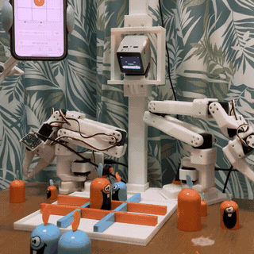
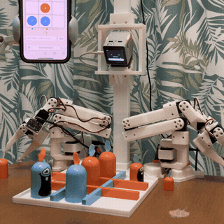
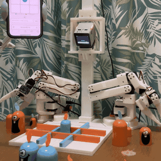
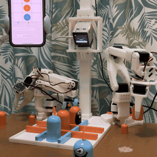
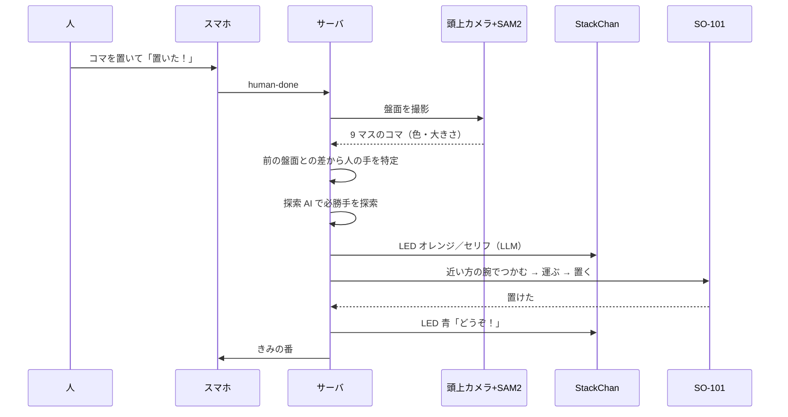
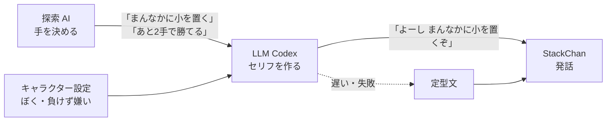
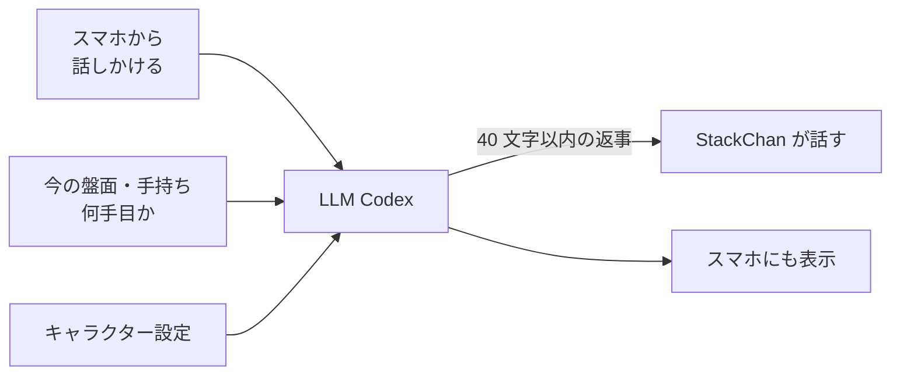
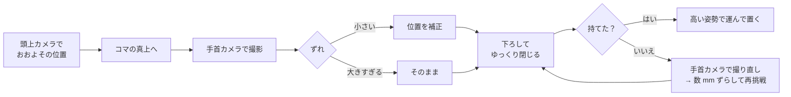
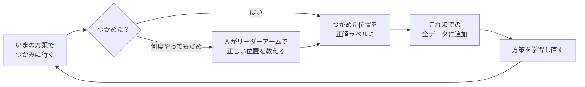
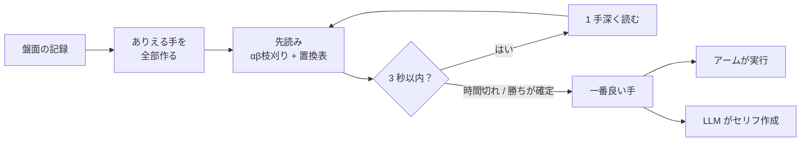

# 双腕StackChan ○× ゲーム

**PAI最終課題_Tiramisu** ／ 人とロボットが、机の上の本物のコマで「ゴブレットゴブラーズ」を対戦するシステム（実機）

<p align="center">
  
  &nbsp;
  
</p>

## コンセプト

> **一人暮らしでも、ボードゲームの相手がいる。**

ボードゲームは、相手がいないと遊べません。オンライン対戦やアプリはあっても、相手は画面の中です。

このシステムでは、双腕ロボットが本物のコマを**自分の目で見て、考えて、手でつかんで置きます**。
進行役の StackChan は、対戦しながら**おしゃべり**もできて、局面に合わせてしゃべり、勝ったら光って踊ります。
画面の中ではなく、**同じ机の上で向かい合って遊べる対戦相手**を目指しました。

| 一人でも遊べる | 本物のコマで遊べる | 話し相手にもなる |
|---|---|---|
| 頭をなでて QR を読むだけで対戦開始。相手はロボットが務める | 人はふつうにコマを手で置くだけ。ロボットがカメラで読み取る | 対戦中いつでもスマホから話しかけられ、StackChan が局面をふまえて声で返事する |

---

## ゲームとシステムの概要

ゴブレットゴブラーズは、大・中・小のコマで相手のコマを**上からかぶせられる**三目並べです。

| だれ / なに | 役割 |
|---|---|
| **StackChan**（中央） | 進行役・話し相手。QR コード表示・対戦中のおしゃべり・ターンごとの LED・勝ったらダンス |
| **SO-101 ×2**（左右） | オレンジのコマを置き場や盤からつかみ、マスに置く |
| **頭上カメラ + SAM2** | コマの位置・大きさと盤面を読み取る |
| **手首カメラ ×2** | つかむ直前に、コマとのずれを mm 単位で補正 |
| **探索 AI + LLM（Codex）** | 先読みして必勝手を選び、局面に合わせた StackChan のセリフや返事を作る |
| **スマホ Web アプリ** | 人はコマを置いて「置いた！」を押すだけ。StackChan への話しかけもここから |

---

## Pick and Place（実機、4倍速）

左右の SO-101 が、置き場のコマをつかんで運び、盤のマスに置きます。大きいコマで、相手のコマにかぶせることもできます。

| 置き場の大をつかんで盤へ | 反対の腕で大をつかんで盤へ |
|---|---|
|  |  |
| **最初の 1 手を置く** | **つかんで運び、マスに置く** |
|  |  |

---

## システム全体


## 1 手の流れ



---

## ハードウェア（CAD）

カメラの柱、StackChan の台、左右のアームの台、盤のベースを 3D プリントで作り、すべて 1 つの座標系で設計しています。

| 斜めから | 真上から |
|---|---|
|  |  |

- 中央の柱の上に頭上カメラ、中段に StackChan
- 左右に SO-101 アーム（右手・左手）
- 手前に 3×3 の盤。左右の机の上がロボットのコマの置き場

---

## スマホ Web アプリ

StackChan の頭をなでると顔が QR コードになり、スマホで読み取ると対戦ページが開きます。

<p align="center"></p>

| 画面 | 内容 |
|---|---|
| 左：ロビー | 先手・後手を選ぶ。初心者向けの「てかげんモード」も選べる |
| 右：きみの番 | 盤面（下にかぶったコマの数も表示）と、残りのコマ。大きな「置いた！」ボタン |
| どの画面でも | 下の入力欄から StackChan に話しかけられる。StackChan が最後に言ったセリフも画面に表示 |

てかげんモードでは、ロボットがときどき（約 35%）一番良い手ではない手を選びます。ただし、勝ちが読み切れた局面では手加減しません。

---

## StackChan のセリフ

StackChan は「明るく、ちょっと生意気で、負けず嫌いだけど優しい」キャラクターです。一人称は「ぼく」。
手を決めるのは探索 AI で、LLM（Codex）は**決まった手と局面を受け取って、その場に合った一言を作る**役です。
LLM の返事が遅いとき（またはオフラインのとき）は、用意した定型文から選びます。

| 場面 | 作り方 | 実際のセリフの例（実機のログより） |
|---|---|---|
| 頭をなでたとき | 定型文 | 「ゴブレットで勝負しよう！スマホでQRコードを読みとってね。」 |
| 対戦開始 | 定型文 | 「よろしくね！ぼく、けっこう強いよ。」「勝負だ！手加減しないからね。」 |
| 人がコマを置いた | LLM | 「まんなかね ぼくは負けないぞ」「おっと大きいの来たね でも負けないよ」 |
| ロボットの手 | LLM | 「よーし まんなかに小を置くぞ」「まんなかの大を奥の左へ行かせるよ」 |
| 勝ちが見えたとき | LLM | 「大を奥のまんなかに置くよ ぼくの勝ち筋だよ」「奥の右に中を置くよ、勝ち筋見えたぞ」 |
| 人の番に戻る | 定型文 | 「きみの番だよ。」「どうぞ！」 |
| ロボットの勝ち | LLM | 「やったあ ぼくの勝ちだよ」 |
| 人の勝ち | LLM | （定型文の例）「うわー、負けちゃった！強いね！」「くやしい！もう一回！」 |
| スマホから話しかけたとき | LLM | 局面をふまえて 40 文字以内で返事 |

LLM に渡しているのは、キャラクター設定・今の盤面・これから打つ手（と「あと何手で勝てるか」）だけです。
「声に出して言う一言だけを、30 文字以内、記号や絵文字なし」で返すように指示しています。



### 対戦中のおしゃべり

対戦の途中でも、スマホの入力欄から StackChan に話しかけられます。
LLM には、キャラクター設定と話しかけられた言葉に加えて、**今の盤面（9 マスの一番上のコマ）・お互いの手持ちのコマ・何手目か**を渡すので、局面をふまえた返事になります。
返事は StackChan が声に出して話し、スマホの画面にも表示されます。

| 話しかけ方の例 | 返事のしかた |
|---|---|
| 「今どっちが有利？」 | 盤面を見て答える |
| 「手加減してよ」 | キャラクターらしく（負けず嫌いだけど優しく）返す |
| 「そのコマずるい！」 | 局面に合わせて言い返す |

返事を考えている間もゲームは止まりません（別の処理で動かしています）。LLM が使えないときは「えへへ、なになに？」と返します。



---

## 認識（AI）

### 頭上カメラ + SAM2 でコマを検出

色でコマの候補点を見つけ、SAM2 に点プロンプトとして渡してセグメンテーションします。面積の順位から S/M/L を判定し、カメラ座標 → 机の座標 → 各アームの座標に変換します。

<p align="center"></p>

### 盤面認識

9 マスごとに一番上のコマの色と大きさを推定し、前の盤面との差から人の手を特定します。

<p align="center"></p>

### 手首カメラで最後の数 mm を補正

アームがコマの真上に来たら手首カメラで撮影します。人が教えた「コマがちょうど指の真ん中にあるときの画像位置」とのずれを、画像ヤコビアン（px/mm）で mm に直して位置を合わせます。

<p align="center"></p>



### つかみ損ねたときの微調整を DAgger で学習

画像ヤコビアンの補正は、照明やコマの向きによってずれが残り、つかみ損ねることがありました。そこで、**手首カメラの画像から「あと何 mm 動けばつかめるか」を出すニューラルネットの方策**を、模倣学習の手法 **DAgger（Dataset Aggregation）** で育てます。

| 項目 | 内容 |
|---|---|
| 入力 | コマの真上で撮った手首カメラの画像 + 腕（左右）・コマの大きさ・つかむ向き |
| 出力 | ホバー位置の補正量 (dx, dy) mm |
| モデル | ResNet18（ImageNet 事前学習、最後のブロックだけ学習）+ 5 個の出力ヘッド（アンサンブル）。ヘッドどうしの意見の割れ具合を「自信のなさ」として使う |
| エキスパート | ロボットがあきらめたら、人が **テレオペ用のリーダーアーム** でフォロワーを動かし、「ここでつかむ」を教える（リーダーのグリッパを握ると決定） |
| ラベル | つかめた位置から逆算して、途中で通ったすべての画像に正解の移動量を付ける（後知恵ラベル）。人が教えた位置はそのまま正解（重み 2 倍） |



普通の模倣学習（人のお手本だけで学ぶ）では、ロボットが少しずれた場所に行くと、お手本に無い画像になって失敗が積み重なります。DAgger では **方策が自分で動いて行った場所の画像** に人が正解を付けて足していくので、ロボットが実際に出会うずれ方から学べます。
学習済みの方策があれば、対戦中のつかみ補正も自動でそれを使い、無いときは画像ヤコビアンに戻ります。対戦中のつかみもデータとして記録されます。

---

## 次の手を決める（探索 AI）

将棋やチェスの AI と同じ「ゲーム木探索」で、ロボットの手を決めます。C で書いて速くし（[game/solver.c](game/solver.c)）、Python から呼び出しています。

### 先読みのしかた

自分の手 → 相手の手 → 自分の手…と、ありえる手を木の形に広げて、何手も先まで読みます。相手もいちばん良い手を打つと考えて、最後に一番得をする手を選びます（ネガマックス法）。

| しくみ | 内容 |
|---|---|
| αβ枝刈り | 「この手はもう選ばれない」と分かった枝は、それ以上読まない |
| 置換表 | 違う順番で同じ盤面になったら、前に読んだ結果を使い回す（約 400 万局面ぶん記録） |
| 反復深化 | 1 手先 → 2 手先 → … と少しずつ深く読み、制限時間（3 秒）が来たら、そこまでの一番良い手を使う |
| 手の並べ替え | 前に良かった手・すぐ勝てる手・大きいコマの手から先に調べて、枝刈りを効きやすくする |

### 勝ち負けの付け方

| 局面 | 点数 |
|---|---|
| 勝ち・負けが決まった | 勝ちは大きなプラス、負けは大きなマイナス。**早く勝つほど高く、負けるならなるべく遅く**なるようにする |
| 読み切れなかった | 盤面の形で点を付ける：あと 1 つでそろう列（+30）、相手のいない列に自分のコマ（+4）、まんなかを取っている（+6）、大きいコマを手元に残している（1 個 +6） |

勝ちが読み切れたらそこで探索をやめ、「あと何手で勝てるか」を StackChan のセリフ（LLM）に渡します。

### ゴブレットゴブラーズならではのルール

- 小さいコマに大きいコマをかぶせられる。盤上のコマを動かすこともできる
- 盤上のコマを持ち上げたときに、下から相手のコマが出てきて相手の列がそろったら、動かした側の負け

盤面は「プレイヤー × 大きさ」ごとに 9 マスのビット列（9 bit × 6 本）で表し、かぶせられて見えないコマも含めて正確に扱っています。



---

## 工夫した点

「見る → 考える → 動く → 確かめる → 話す」を、人の手を借りずにロボットが自分で回すことを目指しました。

### 1. AI で見る・考える・話す

| 工夫 | 内容 |
|---|---|
| 基盤モデル SAM2 でコマを認識 | 学習なし（ゼロショット）で、色の候補点をプロンプトにして SAM2 がコマの形を切り出す。自分で学習データを集めてモデルを作らなくても使える |
| 盤面の変化から人の手を推定 | 9 マスの認識結果と前の盤面を比べ、ルール上ありえる手の中から一番もっともらしい手を自動で選ぶ |
| 探索 AI が必勝手を選ぶ | 将棋・チェスの AI と同じゲーム木探索（ネガマックス + αβ枝刈り + 置換表 + 反復深化）。C で高速化し、制限時間内に何手も先まで読んで、勝てる手・最短で勝つ手を選ぶ。負けそうな局面では一番長く粘る手を選ぶ |
| LLM がキャラクターとして話す | 決まった手と局面を LLM（Codex）に渡し、StackChan らしい一言をその場で生成。返事が遅いときは定型文に切り替えて、対戦のテンポを崩さない |
| 対戦しながら会話できる | 対戦中いつでもスマホから話しかけられ、盤面・手持ちのコマをふまえて StackChan が声で返事する。一人でも「誰かと遊んでいる」感覚になる |
| LLM がロボットのプログラムを書く（試作） | 置き間違いを直すため、LLM がロボットの命令を組み合わせた復帰プログラムを書く Code-as-Policies を試作 |

### 2. カメラで確かめながら自律的に動く

| 工夫 | 内容 |
|---|---|
| 腕の自動選択 | 残りのコマと置き場所から、届く方・近い方の腕を自動で選ぶ |
| 2 段階のカメラ補正 | 頭上カメラでおおよその位置へ → 手首カメラで最後の数 mm を合わせる（ビジュアルサーボ） |
| 触って確かめるつかみ方 | グリッパのモータが止まった位置で接触を検出してから少しだけ締める。少し持ち上げて締め直し、開き量の変化で「持てたか」を自分で判定 |
| 自動の干渉回避 | 手首カメラ・他のコマ・盤まで含めた 3D モデルで当たり判定をして軌道を作る。運ぶときは高い姿勢を通り、盤の大きいコマは指先が仕切り板より上を通る高さでつかむ |
| 失敗からの自動リカバリー | つかみ損ねたら手首カメラで撮り直して再挑戦、だめなら数 mm ずつずらす。モータが止まったら少し戻って別の経路でやり直す |
| 置けたかを自分で確認 | 置いた後に頭上カメラで盤を見て、動かしたマスが正しいかを確認する。カメラの読み違いで盤面の記録は書き換えない |

### 3. 人から学ぶ

| 工夫 | 内容 |
|---|---|
| 人が教える補正（デモンストレーションからの学習） | アームがコマの上で止まり、人がコマを指の真ん中に寄せると、その時の手首カメラの見え方を「正解」として記録 |
| 画像ヤコビアンの自動計測 | 教えるときに、アームが自分で 10mm ずつ 2 回動いて、画像上のずれ（px）と実際の移動量（mm）の関係を測る |
| DAgger でつかみ補正を学習 | つかみ損ねたときは人がリーダーアームで正しい位置を教え、その画像と、ロボットが自分でつかめた画像を集めて、手首カメラの画像から補正量を出す方策を学習し直す。集める → 学習 → また集める、をくり返して方策を育てる |
| キャリブレーションの自動化 | 盤の 4 隅をアームでタッチし、頭上カメラの座標と各アームの座標の対応を自動で求める |

### 4. 人が楽しめる演出

StackChan がターンごとに LED の色を変え、ロボットが勝つと虹色に光って踊ります。
初めての人や子ども向けに「てかげんモード」も用意しました。

| 場面 | StackChan の LED |
|---|---|
| 人の番 | 青くゆっくり光る |
| ロボットの番 | オレンジが回る |
| ロボットの勝ち | 虹色 + ダンス |
| 人の勝ち | 青く点滅 |
| 引き分け | 紫 |

---

## フォルダ構成

```
.
├── game/          ルール、盤面、探索 AI（C で高速化した libsolver）
├── perception/    頭上カメラ、盤の座標変換、SAM2 コマ検出
├── robot/         SO-101 の運動学・干渉チェック・軌道、つかむ / 置く、手首カメラ補正、キャリブレーション
│   ├── move_test.py      つかんで運んで置く処理の本体
│   ├── wrist_servo.py    やさしいつかみ方、持てたかの判定
│   ├── wrist_refine.py   手首カメラ補正
│   ├── wrist_teach.py    人が教える補正モード
│   ├── dagger*.py        DAgger（方策・データ収集・リーダーアームのエキスパート・学習・グラフ）
│   └── touch_board.py    盤の 4 隅タッチで座標合わせ
├── server/        ゲーム進行サーバ
│   ├── game_server.py    進行・API・LED・検証
│   ├── stackchan.py      StackChan（発話・QR・LED・ダンス）
│   ├── codex_llm.py      LLM でセリフ生成
│   ├── cap.py            Code-as-Policies（失敗時の復帰、試作）
│   └── web/index.html    スマホ Web アプリ
└── tests/         ルール・探索 AI のテスト
```

## 動かし方（参考）

```bash
python server/game_server.py --arm on --vision on
```

起動後、StackChan の頭をなでると QR コードが出ます。スマホで読み取ると対戦ページが開きます。
アームやカメラなしで画面だけ試すときは `--arm off --vision off` で起動できます。

DAgger のデータ集めと学習：

```bash
python robot/dagger_collect.py right --episodes 15   # いまの方策でつかむ（だめならリーダーアームで教える）
python robot/dagger_train.py                          # 集めた全データで学習し直す → 次のラウンド
python robot/dagger_report.py                         # ラウンドごとの成功率・誤差のグラフ
```

実機のキャリブレーション値（`out/`）と SAM2 の重み（`models/`）は環境依存なので、リポジトリには含めていません。
