# 双腕StackChan ○× ゲーム

**PAI最終課題_Tiramisu** ／ 人とロボットが、机の上の本物のコマで「ゴブレットゴブラーズ」を対戦するシステム（実機）

<p align="center">
  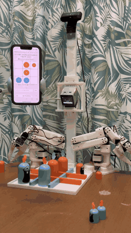
  &nbsp;
  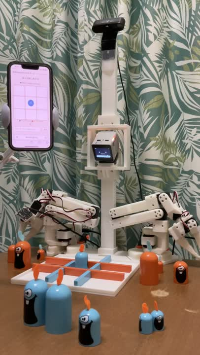
</p>

ゴブレットゴブラーズは、大・中・小のコマで相手のコマを**上からかぶせられる**三目並べです。

| だれ / なに | 役割 |
|---|---|
| **StackChan**（中央） | 進行役。QR コード表示・会話・ターンごとの LED・勝ったらダンス |
| **SO-101 ×2**（左右） | オレンジのコマを置き場や盤からつかみ、マスに置く |
| **頭上カメラ + SAM2** | コマの位置・大きさと盤面を読み取る |
| **手首カメラ ×2** | つかむ直前に、コマとのずれを mm 単位で補正 |
| **ソルバ + LLM（Codex）** | 必勝手を選び、局面に合わせた StackChan のセリフを作る |
| **スマホ Web アプリ** | 人はコマを置いて「置いた！」を押すだけ |

---

## システム全体

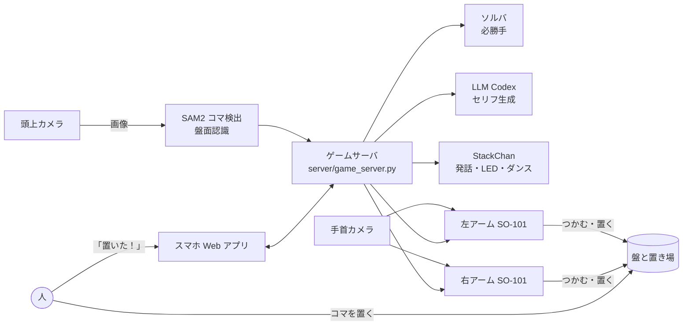

## 1 手の流れ

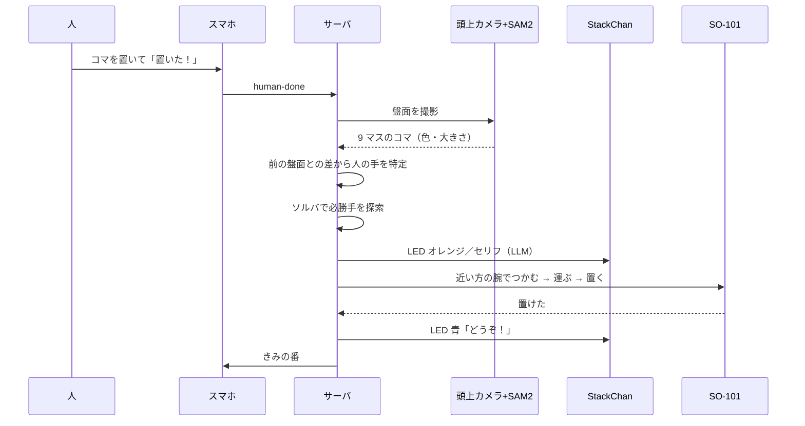

---

## ハードウェア（CAD）

カメラの柱、StackChan の台、左右のアームの台、盤のベースを 3D プリントで作り、すべて 1 つの座標系で設計しています。

| 斜めから | 真上から |
|---|---|
| 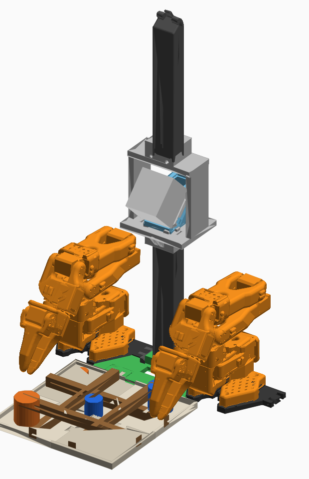 | 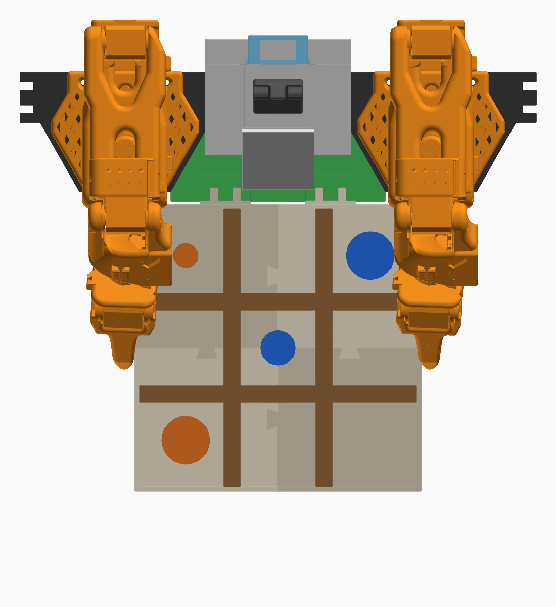 |

- 中央の柱の上に頭上カメラ、中段に StackChan
- 左右に SO-101 アーム（右手・左手）
- 手前に 3×3 の盤。左右の机の上がロボットのコマの置き場

---

## スマホ Web アプリ

StackChan の頭をなでると顔が QR コードになり、スマホで読み取ると対戦ページが開きます。

<p align="center">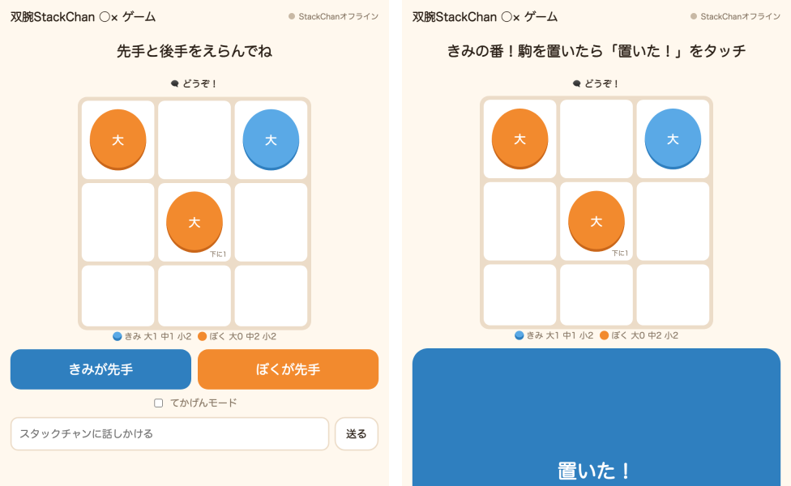</p>

| 画面 | 内容 |
|---|---|
| 左：ロビー | 先手・後手を選ぶ。StackChan に文字で話しかけることもできる |
| 右：きみの番 | 盤面（下にかぶったコマの数も表示）と、残りのコマ。大きな「置いた！」ボタン |

---

## 認識（AI）

### 頭上カメラ + SAM2 でコマを検出

色でコマの候補点を見つけ、SAM2 に点プロンプトとして渡してセグメンテーションします。面積の順位から S/M/L を判定し、カメラ座標 → 机の座標 → 各アームの座標に変換します。

<p align="center">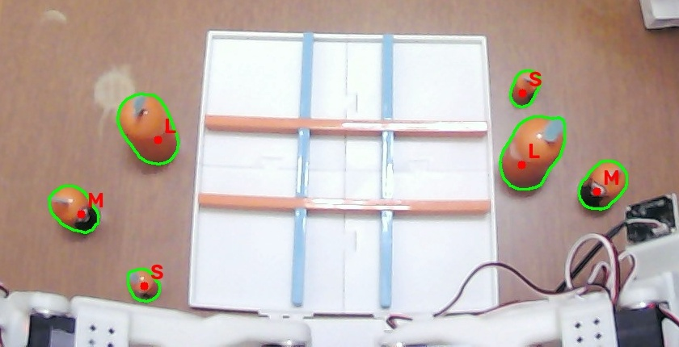</p>

### 盤面認識

9 マスごとに一番上のコマの色と大きさを推定し、前の盤面との差から人の手を特定します。

<p align="center">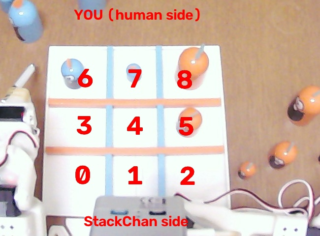</p>

### 手首カメラで最後の数 mm を補正

アームがコマの真上に来たら手首カメラで撮影します。人が教えた「コマがちょうど指の真ん中にあるときの画像位置」とのずれを、画像ヤコビアン（px/mm）で mm に直して位置を合わせます。

<p align="center">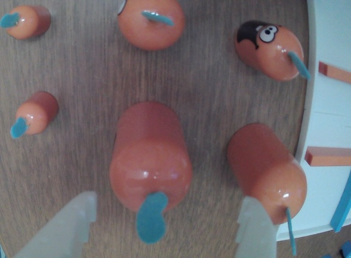</p>

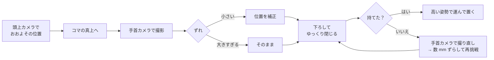

---

## 工夫した点

| 工夫 | 内容 |
|---|---|
| 2 本の腕の使い分け | 残りのコマと置き場所から、届く方・近い方の腕を自動で選ぶ。左右それぞれ、盤の 4 隅をタッチして座標変換を作った |
| やさしく確実なつかみ方 | ゆっくり閉じ、モータが止まった位置（接触）から少しだけ締める。少し持ち上げて締め直し、開き量の変化で持てたかを判定 |
| 人が教える補正 | アームがコマの上で止まり、人がコマを指の真ん中に寄せると、その見え方と画像ヤコビアン（10mm のテスト移動 2 回）を記録 |
| ぶつからない動き | 手首カメラ・他のコマ・盤を含めた干渉チェック付きで軌道を作る。運ぶときは高い姿勢を通る。盤の大きいコマは、指先が仕切り板より上を通る高さでつかむ |
| 失敗からの立て直し | つかみ損ねたら撮り直して再挑戦、だめなら数 mm ずつずらす。モータが止まったら少し戻って別の経路でやり直す |
| 記録を正とする | カメラの読み違いで盤面の記録を書き換えない。成功判定も動かしたマスだけで行う |
| StackChan の演出 | 下の表のとおり LED を切り替え、勝つと虹色に光って踊る |

| 場面 | StackChan の LED |
|---|---|
| 人の番 | 青くゆっくり光る |
| ロボットの番 | オレンジが回る |
| ロボットの勝ち | 虹色 + ダンス |
| 人の勝ち | 青く点滅 |
| 引き分け | 紫 |

---

## フォルダ構成

```
.
├── game/          ルール、盤面、ソルバ（C で高速化した libsolver）
├── perception/    頭上カメラ、盤の座標変換、SAM2 コマ検出
├── robot/         SO-101 の運動学・干渉チェック・軌道、つかむ / 置く、手首カメラ補正、キャリブレーション
│   ├── move_test.py      つかんで運んで置く処理の本体
│   ├── wrist_servo.py    やさしいつかみ方、持てたかの判定
│   ├── wrist_refine.py   手首カメラ補正
│   ├── wrist_teach.py    人が教える補正モード
│   └── touch_board.py    盤の 4 隅タッチで座標合わせ
├── server/        ゲーム進行サーバ
│   ├── game_server.py    進行・API・LED・検証
│   ├── stackchan.py      StackChan（発話・QR・LED・ダンス）
│   ├── codex_llm.py      LLM でセリフ生成
│   ├── cap.py            Code-as-Policies（失敗時の復帰、試作）
│   └── web/index.html    スマホ Web アプリ
└── tests/         ルール・ソルバのテスト
```

## 動かし方（参考）

```bash
python server/game_server.py --arm on --vision on
```

起動後、StackChan の頭をなでると QR コードが出ます。スマホで読み取ると対戦ページが開きます。
アームやカメラなしで画面だけ試すときは `--arm off --vision off` で起動できます。

実機のキャリブレーション値（`out/`）と SAM2 の重み（`models/`）は環境依存なので、リポジトリには含めていません。
